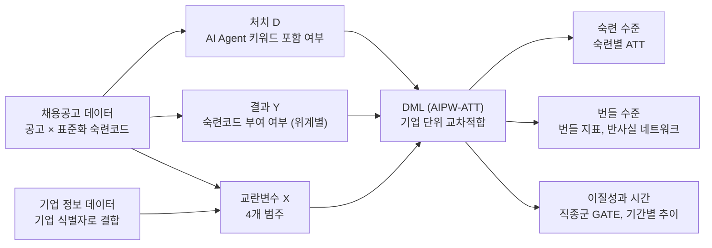
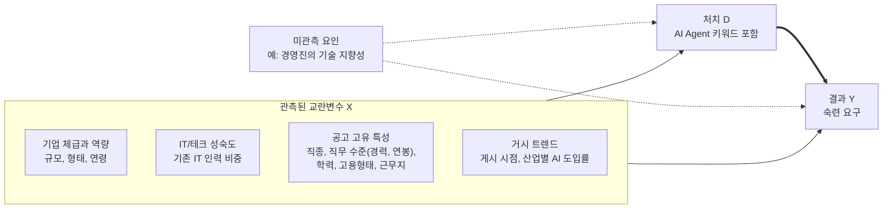
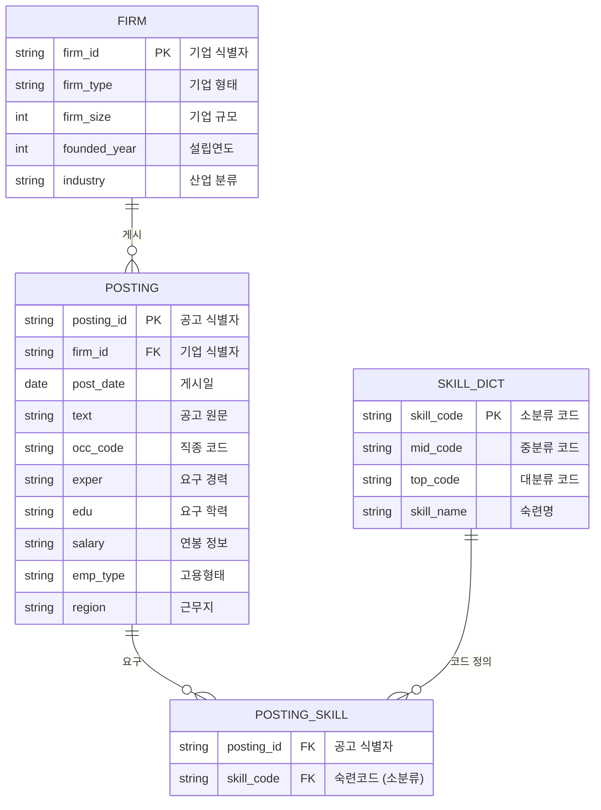
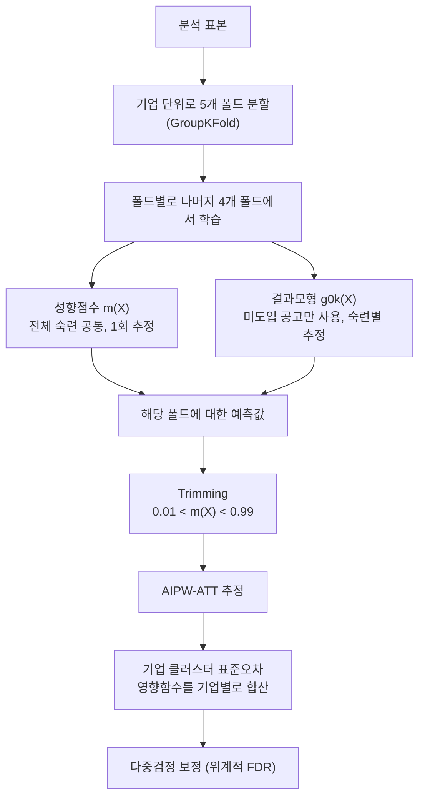
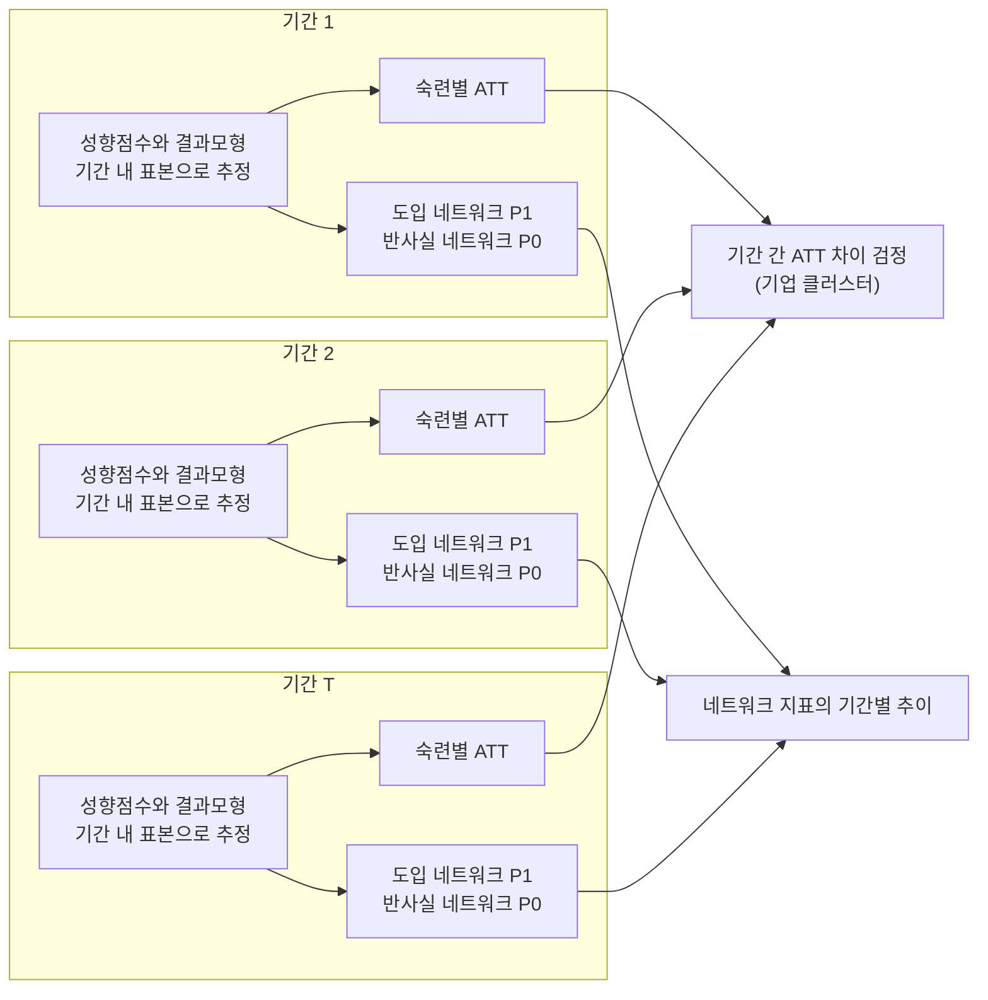
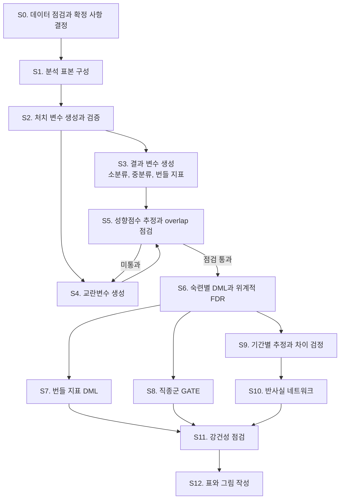

# DML 기반의 AI Agent 도입으로 인한 숙련셋 변화 분석

**연구계획서 (분석 설계 및 실행 지침)** · 작성일 2026-11-11

> 이 문서는 연구의 대상(What), 근거(Why), 방법(How)을 정리하고, 문서만으로 분석을 실행할 수 있도록 변수 정의, 추정 절차, 점검 기준, 코드 템플릿을 담는다. 데이터에 따라 달라지는 값은 `확정 필요`로 표시하고 [10장](#10-실행-전-확정-사항)에 모았다.

## 목차

0. [한눈에 보기](#0-한눈에-보기)
1. [What: 연구 질문과 추정 대상](#1-what-연구-질문과-추정-대상)
2. [Why: 설계 근거](#2-why-설계-근거)
3. [How (1) 데이터와 변수](#3-how-1-데이터와-변수)
4. [How (2) 추정 방법](#4-how-2-추정-방법)
5. [How (3) 분석 모듈](#5-how-3-분석-모듈)
6. [How (4) 실행 절차](#6-how-4-실행-절차)
7. [강건성 점검](#7-강건성-점검)
8. [산출물 계획](#8-산출물-계획)
9. [한계와 해석 범위](#9-한계와-해석-범위)
10. [실행 전 확정 사항](#10-실행-전-확정-사항)
- [부록 A. 코드 템플릿](#부록-a-코드-템플릿)
- [부록 B. 템플릿 검증 결과](#부록-b-템플릿-검증-결과)
- [부록 C. 기호와 용어](#부록-c-기호와-용어)

---

## 0. 한눈에 보기

| 구분 | 내용 |
|---|---|
| **What** | AI Agent 관련 키워드가 포함된 채용공고(도입)와 그렇지 않은 공고(미도입)에서 요구되는 숙련 번들이 어떻게 다른지를 개별 숙련 단위로 추정한다. |
| **Why** | AI Agent 도입 공고는 기업 규모, IT 성숙도, 직종, 시기가 미도입 공고와 체계적으로 다르다. 단순 비교는 이 차이를 숙련 차이로 오인한다. 교란변수가 많고 결과변수(숙련)가 수백 개이므로, 교란을 유연하게 보정하면서 유효한 추론을 주는 DML이 적합하다. |
| **How** | 공고 단위 횡단면에서 숙련별 ATT를 AIPW 방식 DML로 추정한다. 교차적합과 표준오차는 기업 단위로 묶는다. 직종 간 차이는 GATE로, 시간에 따른 변화는 기간별 반복 횡단면으로, 번들 구조 변화는 반사실 네트워크로 본다. |



*그림 1. 연구 설계 개요*

---

## 1. What: 연구 질문과 추정 대상

### 1.1 연구 질문

| 번호 | 연구 질문 | 대응 분석 |
|---|---|---|
| RQ1 | AI Agent 도입 공고는 관측 특성이 유사한 미도입 공고에 비해 어떤 숙련을 더 요구하고 어떤 숙련을 덜 요구하는가? | 숙련별 ATT ([5.1](#51-모듈-1-숙련-수준-att-rq1)) |
| RQ2 | 숙련 번들의 구성과 숙련 간 결합 구조는 어떻게 다른가? | 번들 지표 ([5.2](#52-모듈-2-번들-지표-rq2)), 반사실 네트워크 ([5.5](#55-모듈-5-반사실-네트워크-rq2-rq4)) |
| RQ3 | 이 차이는 직종에 따라 어떻게 다른가? | 직종군 GATE ([5.3](#53-모듈-3-직종군별-이질성-gate-rq3)) |
| RQ4 | 이 차이는 시간이 지나면서 어떻게 변하는가? | 기간별 반복 횡단면 ([5.4](#54-모듈-4-기간별-반복-횡단면-rq4)) |

### 1.2 추정 대상

공고 $i$, 숙련 $k$에 대해 $Y_{ik}(1)$은 도입 공고일 때, $Y_{ik}(0)$은 미도입 공고일 때의 숙련 $k$ 요구 여부이다.

**숙련별 ATT (주 추정 대상)**

$$\theta_k = E\big[\,Y_{ik}(1) - Y_{ik}(0) \mid D_i = 1\,\big]$$

도입 공고가 요구하는 숙련 $k$의 비율이, 같은 공고가 미도입이었다면 요구했을 비율과 몇 %p 다른지를 뜻한다.

**직종군별 효과 (GATE)**

$$\theta_k(g) = E\big[\,Y_{ik}(1) - Y_{ik}(0) \mid D_i = 1,\ G_i = g\,\big]$$

**기간별 효과와 그 변화**

$$\theta_{k,t} = E\big[\,Y_{ik}(1) - Y_{ik}(0) \mid D_i = 1,\ T_i = t\,\big], \qquad \Delta\theta_k = \theta_{k,t} - \theta_{k,t-1}$$

**반사실 네트워크**

$$P^{1}_{kl} = E\big[\,Y_{ik}Y_{il} \mid D_i = 1\,\big], \qquad P^{0}_{kl} = E\big[\,Y_{ik}(0)\,Y_{il}(0) \mid D_i = 1\,\big]$$

$P^1$은 도입 공고에서 관측되는 숙련 동시출현 구조이고, $P^0$은 도입 공고가 미도입이었다면 나타났을 동시출현 구조이다. 두 네트워크의 차이가 번들 구조의 변화이다.

### 1.3 이 설계가 말할 수 있는 것과 없는 것

| 말할 수 있는 것 | 말할 수 없는 것 |
|---|---|
| 직종, 직무 수준, 기업 특성, 시기가 같은 공고끼리 비교했을 때 도입 공고와 미도입 공고의 숙련 요구 차이 | 특정 기업이 AI Agent를 도입한 전후에 숙련 요구가 어떻게 바뀌었는지 |
| 그 차이가 직종에 따라, 시기에 따라 어떻게 다른지 | 재직자의 실제 숙련 변화 (공고는 신규 채용 수요만 반영) |
| 도입 공고의 숙련 결합 구조가 반사실 대비 어떻게 다른지 | 미관측 교란이 전혀 없다는 보장 (민감도 분석으로 범위만 제시) |

---

## 2. Why: 설계 근거

### 2.1 왜 단순 비교가 아니라 DML인가

1. **교란이 강하다.** AI Agent 공고는 대기업, IT 성숙도가 높은 기업, 개발 직종, 최근 시점에 몰린다. 이 요인들은 숙련 요구에도 직접 영향을 준다.
2. **교란변수가 많고 관계가 비선형이다.** 직종 코드, 근무지, 산업처럼 범주가 많은 변수와 그 상호작용을 선형 회귀로 지정하기 어렵다. DML은 이 부분을 기계학습에 맡긴다.
3. **추론이 유효하다.** 기계학습으로 교란을 보정하면 정규화 편향과 과적합 편향이 생긴다. DML은 Neyman 직교 점수와 교차적합으로 이를 제거해 표준오차와 신뢰구간을 그대로 쓸 수 있게 한다.
4. **결과변수가 수백 개다.** 성향점수는 모든 숙련에 공통이므로 한 번만 추정하고, 숙련별로는 결과모형만 추정하면 된다.

### 2.2 인과 구조



*그림 2. 가정하는 인과 구조. 실선은 관측된 교란 경로, 굵은 선은 추정하려는 효과, 점선은 보정하지 못하는 미관측 경로이다.*

### 2.3 설계 결정 기록

| # | 결정 | 검토한 대안 | 선택 이유 |
|---|---|---|---|
| 1 | 분석 단위는 채용공고 | 기업-기간 단위 집계 | 숙련 요구는 공고 단위로 정의되며, 직종과 직무 수준을 공고 단위에서 통제할 수 있다. |
| 2 | 처치는 AI Agent 키워드 포함 여부의 이진 변수 | 구축형과 활용형을 나눈 3수준 처치 | 유형을 직종으로 나누면 유형과 직종이 겹쳐 직종 간 비교가 불가능해진다. 직종별 차이는 GATE로 본다. |
| 3 | 기업 내 도입 전후 비교는 하지 않음 | 기업별 최초 공고 시점을 도입 시점으로 쓰는 event-study | 개별 기업의 도입 전후를 확인할 수 없다. |
| 4 | 교란변수는 4개 범주 전부 사용 (요구 경력, 연봉 포함) | 경력과 연봉을 제외한 모형 | 경력과 연봉은 직무 수준의 대용치이다. 따라서 추정치는 같은 직무 수준 안에서의 숙련 차이로 해석한다. |
| 5 | 추정 대상은 ATT | ATE | 관심은 도입 공고가 도입하지 않았다면 어땠을지에 있다. ATT는 overlap 조건도 한쪽($m(X) < 1$)만 요구한다. |
| 6 | 시간 변화는 기간별 반복 횡단면으로 분석 | 기업 패널 | 기업 패널 없이도 도입과 미도입 간 격차의 추이를 볼 수 있다. |
| 7 | 번들 구조는 반사실 네트워크로 분석 | 집단별 네트워크의 단순 비교 | 단순 비교는 직종과 기업 구성 차이를 번들 차이로 오인한다. ATT 가중으로 구성을 맞춘다. |
| 8 | 교차적합 폴드와 표준오차는 기업 단위 | 공고 단위 무작위 분할 | 같은 기업의 공고는 기업 변수가 같고 숙련 요구가 상관된다. 공고 단위 분할은 누수를 만들고 표준오차를 과소추정한다. |
| 9 | 특허(지적재산권) 수는 교란변수에서 제외 | 게시 시점 이전 누적 특허 수를 IT/테크 성숙도 변수로 사용 | 사용할 수 있는 기업 자료에 지적재산권 정보가 없다. IT/테크 성숙도는 기존 IT 인력 비중으로 측정한다. |

---

## 3. How (1) 데이터와 변수

### 3.1 데이터 구조



*그림 3. 가정하는 데이터 구조. 컬럼명은 예시이며 실제 데이터의 컬럼에 대응시킨다.*

### 3.2 처치 변수

**정의**: $D_i = 1$ (공고 $i$에 AI Agent 관련 키워드 포함), $D_i = 0$ (미포함).

**구성 절차**

1. **키워드 사전 작성.** 엄격한 사전과 넓은 사전 두 벌을 만든다. 주 분석은 엄격한 사전을 쓰고 넓은 사전은 강건성 점검에 쓴다.
2. **제외 패턴 작성.** "에이전트"는 보험, 여행, 부동산 등 다른 의미로 자주 쓰이므로 제외 패턴을 먼저 지운 뒤 사전을 적용한다.
3. **검증.** 처치 공고와 미처치 공고에서 각각 무작위로 100~150건을 뽑아 수작업으로 확인하고 정밀도와 재현율을 보고한다.
4. **처치 정의에 쓰인 숙련코드 제외.** AI Agent에 해당하는 숙련코드가 사전에 있다면 결과변수 목록에서 뺀다. 생성형 AI, LLM처럼 인접한 코드는 빼지 않되 결과표에 "인접 숙련"으로 표시한다. 이 코드들의 양(+)의 효과는 기계적 연관일 수 있다.

| 사전 | 예시 패턴 (확정 필요) |
|---|---|
| 엄격 | `AI\s*agent`, `AI\s*에이전트`, `agentic`, `에이전틱`, `LLM\s*agent`, `멀티\s*에이전트`, `multi[- ]?agent` |
| 넓음 | 엄격 사전 + Agent 프레임워크 명칭, `자율\s*에이전트`, `에이전트\s*오케스트레이션` 등 |
| 제외 | `보험\s*에이전트`, `여행\s*에이전[트시]`, `부동산\s*에이전트`, `스포츠\s*에이전트`, `에이전시` |

구현은 부록 A의 `flag_treatment`를 쓴다.

### 3.3 결과 변수

| 수준 | 변수 | 정의 | 용도 |
|---|---|---|---|
| 소분류 | $Y_{ik}$ | 공고 $i$에 숙련코드 $k$ 부여 여부 (0/1) | 숙련별 ATT, 네트워크 노드 |
| 중분류 | $Y_{im}$ | 중분류 $m$에 속한 숙련이 1개 이상 부여되었는지 (0/1) | 위계적 다중검정의 1단계, 범주 수준 해석 |
| 대분류 | `share_*` | 공고의 숙련 중 대분류별 비중 | 번들 구성 |
| 공고 | `breadth` | 공고에 부여된 숙련 수 | 번들 폭 |
| 공고 | `entropy` | 대분류 비중의 Shannon 엔트로피 | 번들 다양성 |

**희소 숙련 필터 (기본값, 조정 가능)**: 전체 공고 중 출현율 0.1% 이상이고 처치 공고 내 출현이 30건 이상인 소분류 코드만 분석한다. 기준에 못 미치는 코드는 중분류 결과변수에는 그대로 포함한다.

### 3.4 교란변수

| 범주 | 변수 | 측정과 처리 | 주의 사항 |
|---|---|---|---|
| ① 기업 체급과 역량 | 기업 규모 | 종업원 수의 로그 또는 구간 | 결측은 별도 범주 |
| | 기업 형태 | 대기업, 중견, 중소, 스타트업, 공공, 외국계 등 범주형 | |
| | 기업 연령 | 게시 연도 − 설립연도 | |
| | 산업 | 산업 분류 코드 (범주형) | |
| ② IT/테크 성숙도 | 기존 IT 인력 비중 | 해당 기업의 **이전 기간** 공고 중 IT 직종 공고 비율 | 현재 기간 공고로 계산하면 처치 공고가 섞인다. 이전 공고가 없으면 결측 지시변수를 둔다. |
| ③ 공고 고유 특성 | 직종 분류 | 세부 직종 코드 (범주형) | GATE용 직종군 변수는 별도로 만든다 ([5.3](#53-모듈-3-직종군별-이질성-gate-rq3)) |
| | 요구 경력 | 연수 또는 구간 (신입, 경력무관 포함) | 직무 수준 대용치 |
| | 요구 학력 | 범주형 | |
| | 연봉 정보 | 구간 범주 | "회사 내규에 따름" 등 미기재는 **결측 범주**로 둔다. 삭제하면 표본이 편향된다. |
| | 고용형태 | 정규직, 계약직, 인턴 등 | |
| | 근무지 | 시도 단위 범주 | |
| ④ 거시 트렌드 | 게시 시점 | 연-분기 | 기간별 분석에서는 기간 내 분기만 남긴다. |
| | 산업별 평균 AI 도입률 | **직전 기간**의 산업별 AI Agent 공고 비율 | 부록 A의 `add_industry_ai_rate`. 같은 기간의 처치 변수로 계산하면 처치 정보가 교란변수에 새어 들어간다 (표 아래 설명). |

**같은 기간의 처치 변수로 교란변수를 만들지 않는다.** 산업별 도입률을 같은 기간 공고에서 자기 기업만 빼고 계산하면, 그 값이 해당 기업의 처치 공고 수에 따라 기계적으로 달라져 성향점수 모형이 처치 여부를 역으로 알아낸다. 합성 데이터에서 이 방식은 실제로는 산업 효과가 없는데도 성향점수 AUC를 0.72에서 0.83으로 끌어올렸고, 직전 기간 기준으로 바꾸자 0.72로 돌아왔다 (부록 B). 기존 IT 인력 비중도 같은 이유로 이전 기간 공고로만 계산한다. 이를 위해 분석 시작 시점 앞에 변수 산정용 기간을 하나 둔다.

**범주형 변수 처리**: LightGBM은 pandas `category` 타입을 그대로 받으므로 원-핫 인코딩 없이 `astype("category")`로 넣는다. 결측도 그대로 처리된다. 균형 점검(`balance_table`)에는 더미로 바꾼 컬럼을 쓴다 ([6.2](#62-사용-예)).

### 3.5 분석 표본 구성 규칙

1. 동일 기업이 같은 내용으로 재게시한 중복 공고는 최초 1건만 남긴다.
2. 기업 식별자가 없거나 기업 정보와 결합되지 않는 공고는 제외하고, 제외 건수를 보고한다.
3. 숙련코드가 하나도 부여되지 않은 공고의 처리 방침을 정한다 (`확정 필요`). 기본값은 제외이다.
4. 분석 기간과 기간 구분을 확정한다 ([5.4](#54-모듈-4-기간별-반복-횡단면-rq4)).

**분석용 테이블 형태** (공고 1건 = 1행)

| 컬럼 | 설명 |
|---|---|
| `posting_id`, `firm_id` | 식별자 |
| `period`, `quarter` | 기간 구분(연속된 정수), 연-분기 |
| `treat` | 처치 (0/1) |
| `occ_code`, `occ_group` | 세부 직종 코드, GATE용 직종군 |
| `exper`, `edu`, `salary_band`, `emp_type`, `region` | 공고 특성 |
| `firm_size`, `firm_type`, `firm_age`, `industry` | 기업 특성 |
| `it_share_prev`, `ind_ai_rate` | IT 성숙도, 거시 변수 |
| 숙련 컬럼 (소분류 코드별 0/1) | `int8`로 저장해 메모리를 줄인다 |

---

## 4. How (2) 추정 방법

### 4.1 식별 가정

| 가정 | 내용 | 점검 방법 |
|---|---|---|
| 조건부 독립 | $X$가 같으면 미도입 시의 숙련 요구 $Y(0)$는 처치 여부와 무관하다. | 직접 검정할 수 없다. 민감도 분석과 placebo로 간접 점검한다 ([7장](#7-강건성-점검)). |
| Overlap | 모든 도입 공고에 대해 비슷한 $X$를 가진 미도입 공고가 존재한다 ($m(X) < 1$). | 성향점수 분포, trimming 건수, 가중 후 SMD, 유효표본크기 |
| 간섭 없음 | 한 공고의 처치가 다른 공고의 숙련 요구에 영향을 주지 않는다. | 같은 기업 내 파급이 있을 수 있다. 기업 내 파급 보조 분석으로 크기를 확인한다. |

### 4.2 추정량

성향점수 $m(X) = P(D=1 \mid X)$와 미도입 결과모형 $g_0(X) = E[Y \mid D=0, X]$를 기계학습으로 추정한 뒤, 다음 AIPW 방식의 ATT 추정량을 쓴다.

$$\hat\theta_k = \frac{\displaystyle\sum_i \left[ D_i\big(Y_{ik} - \hat g_{0k}(X_i)\big) - \frac{\hat m(X_i)\,(1-D_i)\,\big(Y_{ik} - \hat g_{0k}(X_i)\big)}{1-\hat m(X_i)} \right]}{\displaystyle\sum_i D_i}$$

첫째 항은 도입 공고의 실제 값과 예측된 반사실 값의 차이이고, 둘째 항은 미도입 공고의 예측 오차를 ATT 가중치 $\hat m/(1-\hat m)$로 가중해 결과모형의 편향을 보정한다. 성향점수 모형과 결과모형 중 하나만 정확해도 일치추정량이 된다.

### 4.3 교차적합과 표준오차



*그림 4. 추정 절차*

| 항목 | 설정 (기본값) | 근거 |
|---|---|---|
| 폴드 | 5개, 기업 단위 분할 | 같은 기업의 공고가 학습과 예측에 나뉘지 않게 한다. |
| 학습기 | LightGBM (`n_estimators=300`, `learning_rate=0.05`, `num_leaves=31`) | 범주형과 결측을 그대로 처리하고 비선형과 상호작용을 잡는다. |
| Trimming | $0.01 < \hat m(X) < 0.99$ | 극단적 가중치로 인한 불안정을 막는다. 제외 건수를 보고한다. |
| 표준오차 | 기업 단위 클러스터 | 같은 기업 공고 간 상관을 반영한다. |
| 다중검정 | 위계적 Benjamini-Hochberg, $q < 0.05$ | 중분류에서 먼저 보정하고, 유의한 중분류 안에서만 소분류를 검정한다. |
| 난수 | `SEED = 42` 고정 | 재현성 |

하이퍼파라미터는 성향점수 모형의 교차적합 log-loss를 기준으로 한 번 조정하고 이후 고정한다. 추정 결과를 보고 조정하지 않는다.

---

## 5. How (3) 분석 모듈

### 5.1 모듈 1: 숙련 수준 ATT (RQ1)

- **입력**: 소분류 숙련 컬럼, 교란변수, 처치
- **처리**: `run_skill_dml` → 숙련별 `att`, `se`, `p`, `q`, 도입 공고 평균(`y1_mean`), 반사실 평균(`y0_cf`)
- **보고**: 효과 크기(%p)와 상대 변화(`att / y0_cf`)를 함께 제시한다. 출현율이 낮은 숙련은 %p만으로는 크기를 가늠하기 어렵다.
- **다중검정**: 중분류 결과변수로 같은 추정을 한 번 더 하고 `hierarchical_fdr`을 적용한다.

### 5.2 모듈 2: 번들 지표 (RQ2)

- **처리**: `bundle_metrics`로 공고별 `breadth`, `entropy`, `share_*`를 만들고 같은 `run_skill_dml`에 결과변수로 넣는다. 연속형 결과는 자동으로 회귀 학습기를 쓴다.
- **해석**: `breadth`의 ATT는 도입 공고가 숙련을 몇 개 더 요구하는지, `share_*`의 ATT는 번들 안에서 어느 대분류의 비중이 커지는지를 뜻한다.

### 5.3 모듈 3: 직종군별 이질성 GATE (RQ3)

- **직종군 정의**: 세부 직종 코드를 5~10개 직종군으로 묶은 `occ_group`을 만든다 (`확정 필요`). 세부 직종 코드는 교란변수로 그대로 둔다.
- **처리**: `run_skill_dml(..., subgroup_col="occ_group")`. 성향점수와 결과모형은 전체 표본에서 추정하고, 직종군별로 ATT를 계산한다.
- **최소 표본 (권장)**: 직종군별 trimming 후 처치 공고 200건 이상. 미달하는 직종군은 상위 분류로 묶거나 이질성 분석에서 제외한다.
- **직종군 간 차이 검정**: 두 직종군의 추정치 차이를 $z = (\hat\theta_a - \hat\theta_b)/\sqrt{se_a^2 + se_b^2}$로 검정한다. 같은 기업이 두 직종군에 모두 공고를 내면 이 식은 근사이므로, 핵심 비교는 기업 단위 부트스트랩으로 재확인한다.
- **주의**: 전체 ATT는 처치 공고의 직종 분포로 가중된다. AI Agent 공고가 개발 직종에 몰려 있으면 전체 ATT는 사실상 개발 직종의 효과이다. 직종군별 GATE를 전체 ATT와 나란히 주 결과로 제시한다.

### 5.4 모듈 4: 기간별 반복 횡단면 (RQ4)



*그림 5. 기간별 반복 횡단면과 반사실 네트워크의 결합 구조*

- **기간 단위 결정**: 기간별 처치 공고 수를 먼저 집계한 뒤 분기, 반기, 연 중에서 고른다 (`확정 필요`). 권장 기준은 기간별 trimming 후 처치 공고 500건 이상이다. AI Agent 키워드는 초기 기간에 드물 것이므로 초기 기간은 합치거나 분석 시작 시점을 늦춘다.
- **처리**: 기간별로 표본을 나눠 `run_skill_dml`을 따로 실행한다. 같은 기업 특성이라도 시기에 따라 처치 확률이 달라지므로 성향점수를 기간별로 다시 추정한다.
- **기간 간 차이 검정**: `period_diff`. 같은 기업이 여러 기간에 나타나므로 두 기간의 영향함수를 기업 단위로 합친 뒤 분산을 구한다.
- **해석**: $\Delta\theta_k > 0$이면 도입과 미도입 간 숙련 $k$ 요구 격차가 커지고 있다는 뜻이다. 개별 기업의 변화가 아니라 집단 간 격차의 추이이다.

### 5.5 모듈 5: 반사실 네트워크 (RQ2, RQ4)

| 단계 | 내용 | 함수 |
|---|---|---|
| 1 | 도입 공고의 동시출현 확률 행렬 $P^1$과, 미도입 공고에 ATT 가중치 $\hat m/(1-\hat m)$을 준 반사실 행렬 $P^0$을 만든다. | `counterfactual_networks` |
| 2 | 두 집단의 숙련 출현율이 다르므로 엣지 가중치는 빈도가 아니라 양의 PMI로 정규화한다. 지지도 0.1% 미만인 쌍은 0으로 둔다. | `to_pmi` |
| 3 | 노드 지표(강도, 고유벡터 중심성, 매개 중심성), 엣지 변화(새로 생긴 엣지, 사라진 엣지, 가중치 변화 상위 쌍), 커뮤니티 구조(Louvain 또는 Leiden, 중분류를 해석 기준으로 사용)를 비교한다. | `networkx` 등 |
| 4 | 기업 단위 재표집으로 지표 차이의 신뢰구간을 구한다. | `bootstrap_network_stat` |
| 5 | 변화가 큰 핵심 숙련 쌍은 $Y = 1(k\text{와 } l \text{ 동시 요구})$를 결과변수로 두고 모듈 1의 DML로 직접 검정한다. | `run_skill_dml` |

- 네트워크는 전체 표본과 주요 직종군별로 각각 만든다.
- 4단계의 부트스트랩은 성향점수를 고정한 채 재표집하므로 성향점수 추정의 불확실성을 반영하지 않는다. PMI는 드문 쌍에서 변동이 크다. 따라서 네트워크 지표의 구간은 탐색적 근거로 쓰고, 논문의 핵심 주장은 5단계의 쌍별 DML로 뒷받침한다.

---

## 6. How (4) 실행 절차



*그림 6. 실행 파이프라인*

| 단계 | 작업 | 산출물 | 통과 기준 |
|---|---|---|---|
| S0 | [10장](#10-실행-전-확정-사항)의 항목 확정, 데이터 구조와 결합 키 확인 | 확정 사항 기록 | 모든 항목에 값이 정해짐 |
| S1 | 중복 제거, 기업 정보 결합, 기간 변수 생성 | `sample.parquet` | 제외 사유별 건수 표 작성 |
| S2 | `flag_treatment` 적용, 수작업 검증 | `treat` 컬럼, 검증표 | 정밀도와 재현율 보고. 정밀도가 낮으면 사전 수정 후 재검증 |
| S3 | 처치 정의 코드 제외, 희소 필터, 중분류 변수, `bundle_metrics` | 숙련 컬럼, 번들 지표 | 분석 대상 숙련 수와 제외 숙련 수 기록 |
| S4 | [3.4](#34-교란변수)의 변수 생성 | 교란변수 컬럼 | 시점 규칙(이전 기간, 자기 기업 제외) 준수 확인 |
| S5 | `make_folds`, `fit_propensity`, `balance_table` | 성향점수, 분포 그림, 균형표 | 가중 후 모든 변수의 절대 SMD < 0.1. Trimming 제외 비율, 유효표본크기, 성향점수 AUC 보고 |
| S6 | `run_skill_dml` (소분류, 중분류), `hierarchical_fdr` | 숙련별 결과표 | placebo 숙련의 효과가 0과 구분되지 않음 |
| S7 | 번들 지표를 결과변수로 `run_skill_dml` | 번들 지표 결과표 | |
| S8 | `subgroup_col="occ_group"`으로 재실행 | 직종군별 결과표 | 직종군별 처치 공고 수 기준 충족 |
| S9 | 기간별 `run_skill_dml`, `period_diff` | 기간별 결과표, 추이 그림 | 기간별 처치 공고 수 기준 충족, 기간별 S5 점검 통과 |
| S10 | `counterfactual_networks`, `to_pmi`, `bootstrap_network_stat`, 핵심 쌍 DML | 네트워크 지표표, 네트워크 그림 | |
| S11 | [7장](#7-강건성-점검)의 항목 수행 | 강건성 표 | |
| S12 | [8장](#8-산출물-계획)의 표와 그림 작성 | 논문용 표, 그림 | |

**성향점수 AUC가 1에 가까울 때**: overlap이 실제로 없는 경우와, 처치 정보가 교란변수에 섞인 경우가 있다. 먼저 [3.4](#34-교란변수)의 시점 규칙을 지켰는지 확인한다.

**S5를 통과하지 못할 때**: 성향점수가 1에 몰린 영역(예: 특정 직종 × 대기업)은 비교 대상이 없다는 뜻이다. 해당 영역을 표본에서 제외하고 추정 대상의 범위를 그만큼 좁혀 기술한다.

### 6.1 권장 작업 구조

```text
project/
├── utils/
│   └── dml_utils.py          # 부록 A 템플릿
├── 01_build_sample.ipynb     # S1~S4
├── 02_propensity_overlap.ipynb   # S5
├── 03_skill_dml.ipynb        # S6~S8
├── 04_period_network.ipynb   # S9~S10
├── 05_robustness.ipynb       # S11
├── 06_tables_figures.ipynb   # S12
└── output/
```

### 6.2 사용 예

```python
from utils.dml_utils import *

df = pd.read_parquet("output/sample.parquet")
skill_dict = pd.read_parquet("output/skill_dict.parquet")
df["ind_ai_rate"] = add_industry_ai_rate(df)

X_COLS = ["firm_size", "firm_type", "firm_age", "industry", "it_share_prev",
          "occ_code", "exper", "edu", "salary_band", "emp_type", "region", "quarter", "ind_ai_rate"]
SKILL_COLS = [c for c in df.columns if c.startswith("sk_")]
MID_PARENT = skill_dict.set_index("skill_code")["mid_code"].to_dict()
TOP_PARENT = skill_dict.set_index("skill_code")["top_code"].to_dict()

# S3. 중분류 결과변수(해당 중분류 숙련 1개 이상)와 번들 지표
mid = df[SKILL_COLS].T.groupby(pd.Series(MID_PARENT)).max().T
MID_COLS = list(mid.columns)
bundle = bundle_metrics(df, SKILL_COLS, TOP_PARENT)
df = pd.concat([df, mid, bundle], axis=1)

# S5. 성향점수와 균형 점검 (범주형은 더미로 변환해 점검)
folds = make_folds(df)
ps = fit_propensity(df, X_COLS, "treat", folds)
x_num = pd.get_dummies(df[X_COLS], dummy_na=True, dtype=float).fillna(0).assign(treat=df["treat"])
balance, ess = balance_table(x_num, list(x_num.columns.drop("treat")), ps)

# S6, S8. 숙련별 ATT와 직종군 GATE, 위계적 FDR
res_low, ps, cifs = run_skill_dml(df, SKILL_COLS, X_COLS, subgroup_col="occ_group")
res_mid, _, _ = run_skill_dml(df, MID_COLS, X_COLS)
sig = hierarchical_fdr(res_mid[res_mid.group == "all"], res_low[res_low.group == "all"], MID_PARENT)

# S7. 번들 지표
res_bundle, _, _ = run_skill_dml(df, list(bundle.columns), X_COLS)

# S9. 기간별 추정과 기간 간 차이 검정
by_period = {t: run_skill_dml(g.reset_index(drop=True), SKILL_COLS, X_COLS) for t, g in df.groupby("period")}
(r1, _, c1), (r2, _, c2) = by_period[1], by_period[2]
a1, a2 = (r[r.group == "all"].set_index("skill")["att"] for r in (r1, r2))
diffs = pd.DataFrame({s: period_diff(a1[s], c1[s], a2[s], c2[s]) for s in SKILL_COLS}, index=["diff", "se", "p"]).T

# S10. 반사실 네트워크와 노드 강도 차이의 신뢰구간
p1, p0 = counterfactual_networks(df, SKILL_COLS, ps)
strength = lambda P: to_pmi(P).sum(axis=1)
draws = bootstrap_network_stat(df, SKILL_COLS, ps, strength)
ci_low, ci_high = np.percentile(draws, [2.5, 97.5], axis=0)
```

기간별 추정에도 같은 `X_COLS`를 쓴다. 기간 안에서는 `quarter`가 세부 시점을 통제한다. 계산량은 숙련 수에 비례한다. 성향점수는 한 번만 학습하고, 결과모형은 숙련 수 × 5회 학습한다. 숙련이 수백 개면 `joblib`으로 숙련 단위 병렬화를 한다.

---

## 7. 강건성 점검

| # | 위협 | 점검 방법 | 판단 기준 |
|---|---|---|---|
| 1 | 미관측 교란 (경영진의 기술 지향성 등) | 민감도 분석. 관측된 교란변수(예: 기업 규모)만큼 강한 미관측 교란이 있을 때 결과가 유지되는지 본다. | 주요 숙련의 robustness value와, 벤치마크 변수 대비 강도 보고 |
| 2 | 설계 전반의 타당성 | Placebo 숙련. AI Agent와 무관해야 할 숙련을 결과를 보기 전에 미리 지정한다. | 효과가 0과 구분되지 않음 |
| 3 | 우연한 유의성 | Placebo 처치. 처치 여부를 무작위로 섞어 같은 분석을 반복한다. | 유의한 숙련 비율이 명목 수준 근처 |
| 4 | 처치 측정오차 | 엄격한 사전과 넓은 사전으로 각각 추정한다. | 효과의 부호와 순위가 유지됨 |
| 5 | 극단적 가중치 | Trimming 기준을 (0.01, 0.99), (0.05, 0.95)로 바꾼다. | 추정치 변화가 표준오차 범위 이내 |
| 6 | 학습기 의존성 | LightGBM 대신 정규화 로지스틱 회귀 또는 랜덤포레스트로 재추정한다. | 주요 결과 유지 |
| 7 | 직무 수준 통제의 영향 | 주 모형은 유지하고, 요구 경력과 연봉을 뺀 모형을 보조로 추정해 비교한다 (선택). | 차이가 나는 숙련을 따로 논의 |
| 8 | 기업 내 파급 | 키워드가 없는 공고만 대상으로, 같은 기간 해당 기업에 AI Agent 공고가 있는지를 처치로 두고 추정한다. | 파급의 존재와 방향 보고 |
| 9 | 희소 숙련 필터 | 필터 기준을 바꿔 재추정한다. | 유의한 숙련 목록의 안정성 |

민감도 분석은 `DoubleML` 패키지로 수행한다. 부록 A의 기업 단위 폴드를 그대로 넘겨 같은 설계로 추정한다. `sensitivity_benchmark`는 지정한 관측 변수를 뺐을 때의 교란 강도를 계산해, 미관측 교란이 그 변수만큼 강하다면 추정치가 얼마나 움직이는지 보여준다.

```python
import doubleml as dml

# DoubleML은 수치형 X만 받으므로 범주형을 정수 코드로 바꾼다 (결측은 NaN 유지)
df_num = df.copy()
for col in df_num[X_COLS].select_dtypes("category"):
    df_num[col] = df_num[col].cat.codes.where(df_num[col].notna()).astype(float)

data = dml.DoubleMLData(df_num, y_col="sk_target", d_cols="treat", x_cols=X_COLS, force_all_x_finite=False)
model = dml.DoubleMLIRM(data, ml_g=LGBMClassifier(**LGBM_PARAMS), ml_m=LGBMClassifier(**LGBM_PARAMS),
                        score="ATTE", draw_sample_splitting=False)
model.set_sample_splitting(make_folds(df_num))
model.fit()
model.sensitivity_analysis(cf_y=0.03, cf_d=0.03, rho=1.0)
print(model.sensitivity_summary)
print(model.sensitivity_benchmark(benchmarking_set=["firm_size"]))
```

`DoubleML`의 기본 표준오차는 공고 단위 독립을 가정하므로, 보고하는 표준오차는 부록 A의 기업 클러스터 값을 쓴다.

---

## 8. 산출물 계획

| 번호 | 형태 | 내용 | RQ | 단계 |
|---|---|---|---|---|
| 표 1 | 표 | 표본 구성과 제외 사유별 건수 | | S1 |
| 표 2 | 표 | 도입과 미도입 공고의 기술통계, 가중 전후 SMD | | S5 |
| 그림 A | 히스토그램 | 처치 여부별 성향점수 분포 | | S5 |
| 표 3 | 표 | 숙련별 ATT 상위와 하위 (효과, 표준오차, q값, 반사실 평균) | RQ1 | S6 |
| 그림 B | Volcano plot | 가로축 ATT, 세로축 −log10(q), 중분류별 색 | RQ1 | S6 |
| 표 4 | 표 | 번들 지표의 ATT (숙련 수, 다양성, 대분류 비중) | RQ2 | S7 |
| 그림 C | Heatmap | 직종군 × 주요 숙련의 GATE | RQ3 | S8 |
| 그림 D | 선 그래프 | 주요 숙련의 기간별 ATT와 신뢰구간 | RQ4 | S9 |
| 표 5 | 표 | 기간 간 ATT 차이 검정 | RQ4 | S9 |
| 그림 E | 네트워크 | 도입 네트워크와 반사실 네트워크 비교 (새로 생긴 엣지 강조) | RQ2 | S10 |
| 표 6 | 표 | 노드 중심성 변화 상위 숙련, 핵심 숙련 쌍의 DML 결과 | RQ2 | S10 |
| 그림 F | 선 그래프 | 네트워크 지표의 기간별 추이 | RQ4 | S10 |
| 표 7 | 표 | 강건성 점검 요약 | | S11 |

---

## 9. 한계와 해석 범위

1. **추정 대상의 성격.** 추정치는 AI Agent 채용 신호를 보낸 공고와 관측상 유사한 공고 간의 숙련 요구 차이이다. 미관측 교란이 남을 수 있으므로 "도입으로 인한" 효과라는 해석은 민감도 분석이 허용하는 범위 안에서만 한다.
2. **처치의 측정.** 키워드가 없어도 AI Agent를 도입한 기업이 있다. 이 오분류는 효과를 0 쪽으로 희석한다. 반대로 키워드가 있는 공고에는 Agent를 개발하는 직무와 활용하는 직무가 섞여 있다. 직종군 GATE로 이를 구분해 읽는다.
3. **직무 수준 통제.** 요구 경력과 연봉을 통제하므로 추정치는 같은 직무 수준 안에서의 차이이다. AI Agent 도입이 채용 직무의 수준 자체를 바꾸는 경로는 추정치에 포함되지 않는다.
4. **시간 변화의 해석.** 기간별 추이는 집단 간 격차의 변화이며, 기간마다 도입 공고의 구성이 달라지는 효과가 섞여 있다.
5. **공고 데이터의 범위.** 공고는 신규 채용 수요를 나타내며 재직자의 숙련이나 실제 업무 변화를 직접 보여주지 않는다. 숙련코드 부여 방식의 오류도 결과에 반영된다.

---

## 10. 실행 전 확정 사항

| # | 항목 | 기본값 또는 권장 | 확정값 |
|---|---|---|---|
| 1 | 분석 기간 (시작, 종료) | 기간별 처치 공고 수 확인 후 결정 | |
| 2 | 기간 단위 | 기간별 처치 공고 500건 이상이 되는 가장 짧은 단위 | |
| 3 | 처치 판별 근거 | 공고 원문 키워드 (숙련코드 병용 여부 결정) | |
| 4 | 키워드 사전 (엄격, 넓음, 제외) | [3.2](#32-처치-변수)의 예시에서 출발 | |
| 5 | 결과에서 제외할 숙련코드 | 처치 정의에 쓰인 코드 | |
| 6 | 인접 숙련 목록 | 생성형 AI, LLM 관련 코드 | |
| 7 | 희소 숙련 필터 | 출현율 0.1% 이상, 처치 공고 내 30건 이상 | |
| 8 | 숙련코드가 없는 공고 처리 | 제외 | |
| 9 | 직종군 정의 (GATE용) | 5~10개 | |
| 10 | 변수 산정용 기간 (기존 IT 인력 비중, 산업별 AI 도입률) | 분석 시작 직전 1개 기간 | |
| 11 | Placebo 숙련 목록 | 결과 확인 전에 지정 | |
| 12 | 연봉 구간 | 데이터 분포에 따라 4~6개 구간 + 결측 범주 | |

---

## 부록 A. 코드 템플릿

`utils/dml_utils.py`로 저장해 쓴다. 필요 패키지는 `numpy`, `pandas`, `scipy`, `scikit-learn`, `lightgbm`, `statsmodels`이다.

```python
import numpy as np
import pandas as pd
from scipy import sparse, stats
from sklearn.model_selection import GroupKFold
from lightgbm import LGBMClassifier, LGBMRegressor
from statsmodels.stats.multitest import multipletests

SEED = 42
N_FOLDS = 5
TRIM = (0.01, 0.99)
LGBM_PARAMS = dict(n_estimators=300, learning_rate=0.05, num_leaves=31, random_state=SEED, verbose=-1)


def make_folds(df, group_col="firm_id"):
    """기업 단위 교차적합 폴드"""
    return list(GroupKFold(N_FOLDS).split(df, groups=df[group_col]))


def fit_propensity(df, x_cols, d_col, folds):
    """교차적합 성향점수 m(X): 전 숙련 공통으로 1회 추정"""
    ps = np.zeros(len(df))
    for train, test in folds:
        model = LGBMClassifier(**LGBM_PARAMS)
        model.fit(df.iloc[train][x_cols], df.iloc[train][d_col])
        ps[test] = model.predict_proba(df.iloc[test][x_cols])[:, 1]
    return ps


def fit_outcome_control(df, x_cols, y_col, d_col, folds):
    """미도입 공고만으로 학습한 교차적합 결과모형 g0(X)"""
    g0 = np.zeros(len(df))
    binary = df[y_col].nunique() <= 2
    for train, test in folds:
        ctrl = df.iloc[train]
        ctrl = ctrl[ctrl[d_col] == 0]
        if ctrl[y_col].nunique() < 2:
            g0[test] = ctrl[y_col].mean()
            continue
        model = LGBMClassifier(**LGBM_PARAMS) if binary else LGBMRegressor(**LGBM_PARAMS)
        model.fit(ctrl[x_cols], ctrl[y_col])
        x_test = df.iloc[test][x_cols]
        g0[test] = model.predict_proba(x_test)[:, 1] if binary else model.predict(x_test)
    return g0


def estimate_att(y, d, ps, g0, clusters):
    """AIPW-ATT 추정치, 기업 클러스터 표준오차, 기업별 영향함수 합"""
    p = d.mean()
    resid = y - g0
    num = d * resid - ps * (1 - d) * resid / (1 - ps)
    theta = num.mean() / p
    psi = (num - theta * d) / p
    cluster_if = pd.Series(psi / len(y)).groupby(np.asarray(clusters)).sum()
    se = np.sqrt((cluster_if ** 2).sum())
    return theta, se, cluster_if


def run_skill_dml(df, skill_cols, x_cols, d_col="treat", group_col="firm_id", subgroup_col=None):
    """숙련별 ATT 추정. subgroup_col 지정 시 직종군별 GATE 포함"""
    df = df.reset_index(drop=True)
    folds = make_folds(df, group_col)
    ps = fit_propensity(df, x_cols, d_col, folds)
    keep = (ps > TRIM[0]) & (ps < TRIM[1])
    d, clusters = df[d_col].to_numpy(), df[group_col].to_numpy()

    groups = {"all": keep}
    if subgroup_col:
        groups.update({g: keep & (df[subgroup_col] == g).to_numpy() for g in df[subgroup_col].unique()})

    rows, cluster_ifs = [], {}
    for skill in skill_cols:
        g0 = fit_outcome_control(df, x_cols, skill, d_col, folds)
        y = df[skill].to_numpy()
        for name, mask in groups.items():
            theta, se, cluster_if = estimate_att(y[mask], d[mask], ps[mask], g0[mask], clusters[mask])
            y1 = y[mask & (d == 1)].mean()
            rows.append({"skill": skill, "group": name, "att": theta, "se": se,
                         "y1_mean": y1, "y0_cf": y1 - theta, "n_treat": int(d[mask].sum())})
            if name == "all":
                cluster_ifs[skill] = cluster_if

    res = pd.DataFrame(rows)
    res["p"] = 2 * stats.norm.sf(np.abs(res["att"] / res["se"]))
    res["q"] = res.groupby("group")["p"].transform(lambda p: multipletests(p, method="fdr_bh")[1])
    return res, ps, cluster_ifs


def hierarchical_fdr(res_mid, res_low, parent_map, alpha=0.05):
    """중분류 BH 통과 범주 안에서만 소분류 BH 적용 (group == 'all' 결과 입력)"""
    sig_mid = res_mid.loc[res_mid["q"] < alpha, "skill"]
    low = res_low.assign(parent=res_low["skill"].map(parent_map))
    low = low[low["parent"].isin(sig_mid)].copy()
    low["q_hier"] = low.groupby("parent")["p"].transform(lambda p: multipletests(p, method="fdr_bh")[1])
    return low


def period_diff(theta_a, cluster_if_a, theta_b, cluster_if_b):
    """두 기간 ATT 차이와 기업 클러스터 표준오차 (같은 기업의 기간 간 상관 반영)"""
    diff_if = cluster_if_b.sub(cluster_if_a, fill_value=0)
    diff, se = theta_b - theta_a, np.sqrt((diff_if ** 2).sum())
    return diff, se, 2 * stats.norm.sf(abs(diff / se))


def att_weights(df, ps, d_col="treat"):
    """도입 공고 가중치(1)와 미도입 공고의 ATT 가중치 m/(1-m). trimming 밖은 0"""
    keep = (ps > TRIM[0]) & (ps < TRIM[1])
    d = df[d_col].to_numpy()
    w1 = (keep & (d == 1)).astype(float)
    w0 = np.where(keep & (d == 0), ps / (1 - ps), 0.0)
    return w1, w0


def balance_table(df, x_cols, ps, d_col="treat"):
    """ATT 가중 전후 표준화 평균차(SMD)와 가중 미도입 표본의 유효표본크기"""
    w1, w0 = att_weights(df, ps, d_col)
    X = df[x_cols].to_numpy(dtype=float)
    mean1 = np.average(X, axis=0, weights=w1)
    sd1 = np.sqrt(np.average((X - mean1) ** 2, axis=0, weights=w1))
    sd1 = np.where(sd1 > 0, sd1, np.nan)
    raw0 = np.average(X, axis=0, weights=(w0 > 0).astype(float))
    adj0 = np.average(X, axis=0, weights=w0)
    table = pd.DataFrame({"smd_raw": (mean1 - raw0) / sd1, "smd_weighted": (mean1 - adj0) / sd1}, index=x_cols)
    return table, w0.sum() ** 2 / (w0 ** 2).sum()


def cooccurrence_prob(skill_matrix, weights):
    """가중 동시출현 확률 행렬 P(k,l). 대각 원소는 P(k)"""
    S = sparse.csr_matrix(skill_matrix, dtype=float)
    w = weights / weights.sum()
    return (S.T @ sparse.diags(w) @ S).toarray()


def counterfactual_networks(df, skill_cols, ps, d_col="treat"):
    """도입 네트워크(p1)와 ATT 가중 반사실 네트워크(p0)의 동시출현 확률 행렬"""
    S = sparse.csr_matrix(df[skill_cols].to_numpy(), dtype=float)
    w1, w0 = att_weights(df, ps, d_col)
    return cooccurrence_prob(S, w1), cooccurrence_prob(S, w0)


def bootstrap_network_stat(df, skill_cols, ps, stat_fn, n_boot=500, d_col="treat", group_col="firm_id"):
    """기업 단위 재표집으로 네트워크 통계량 차이(도입 - 반사실)의 분포 산출"""
    rng = np.random.default_rng(SEED)
    S = sparse.csr_matrix(df[skill_cols].to_numpy(), dtype=float)
    w1, w0 = att_weights(df, ps, d_col)
    codes, firms = pd.factorize(df[group_col])
    draws = []
    for _ in range(n_boot):
        mult = np.bincount(rng.integers(0, len(firms), len(firms)), minlength=len(firms))[codes]
        draws.append(stat_fn(cooccurrence_prob(S, w1 * mult)) - stat_fn(cooccurrence_prob(S, w0 * mult)))
    return np.array(draws)


def to_pmi(P, min_support=0.001):
    """동시출현 확률 행렬을 양의 PMI 엣지 가중치로 변환"""
    marg = np.diag(P)
    with np.errstate(divide="ignore", invalid="ignore"):
        pmi = np.log(P / np.outer(marg, marg))
    pmi[(P < min_support) | ~np.isfinite(pmi)] = 0
    np.fill_diagonal(pmi, 0)
    return np.clip(pmi, 0, None)


def bundle_metrics(df, skill_cols, parent_map):
    """공고별 번들 지표: 숙련 수, 상위분류별 비중, 상위분류 다양성(엔트로피)"""
    S = df[skill_cols]
    breadth = S.sum(axis=1)
    counts = S.T.groupby(pd.Series(parent_map)).sum().T
    share = counts.div(breadth.replace(0, np.nan), axis=0).fillna(0)
    entropy = -(share * np.log(share.where(share > 0, 1))).sum(axis=1)
    return share.add_prefix("share_").assign(breadth=breadth, entropy=entropy + 0.0)


def flag_treatment(text, include, exclude=()):
    """제외 패턴을 지운 뒤 포함 사전에 걸리는 공고를 1로 표시"""
    if exclude:
        text = text.str.replace("|".join(exclude), " ", case=False, regex=True)
    return text.str.contains("|".join(include), case=False, regex=True, na=False).astype(int)


def add_industry_ai_rate(df, d_col="treat", industry_col="industry", period_col="period"):
    """직전 기간의 산업별 AI Agent 공고 비율. period는 연속된 정수여야 하며 첫 기간은 결측"""
    keys = [industry_col, period_col]
    rate = df.groupby(keys, observed=True)[d_col].mean().rename("ind_ai_rate").reset_index()
    rate[period_col] += 1
    return df[keys].merge(rate, how="left", on=keys)["ind_ai_rate"].to_numpy()
```

**함수 요약**

| 함수 | 역할 | 사용 단계 |
|---|---|---|
| `flag_treatment` | 키워드 사전으로 처치 변수 생성 | S2 |
| `add_industry_ai_rate` | 직전 기간의 산업별 AI 도입률 | S4 |
| `bundle_metrics` | 공고별 번들 지표 | S3 |
| `make_folds`, `fit_propensity` | 기업 단위 폴드, 교차적합 성향점수 | S5 |
| `balance_table` | 가중 전후 SMD, 유효표본크기 | S5 |
| `run_skill_dml` | 숙련별 ATT와 직종군 GATE | S6~S9 |
| `hierarchical_fdr` | 위계적 다중검정 보정 | S6 |
| `period_diff` | 기간 간 ATT 차이 검정 | S9 |
| `counterfactual_networks`, `to_pmi` | 도입 네트워크와 반사실 네트워크 | S10 |
| `bootstrap_network_stat` | 네트워크 지표 차이의 부트스트랩 분포 | S10 |

---

## 부록 B. 템플릿 검증 결과

참값을 아는 합성 데이터로 템플릿이 의도대로 동작하는지 확인했다. 실제 데이터의 결과를 예측하는 것이 아니라 코드의 정확성을 확인하는 용도이다.

**합성 데이터**: 기업 4,000개, 공고 43,958건, 처치 공고 9,179건(20.9%). 처치 확률과 숙련 요구가 모두 기업 규모, IT 비중, 직종, 경력, 기간에 의존하도록 만들었다. 숙련 12개 중 4개에만 효과를 넣었고, 효과는 직종과 기간에 따라 다르게 했다. 기업 단위 임의효과로 기업 내 상관을 넣었다.

| 점검 항목 | 결과 |
|---|---|
| 숙련별 ATT의 평균 절대오차 | DML 0.0045, 단순 평균 차이 0.0208 |
| 95% 신뢰구간이 참값을 포함한 숙련 수 (전체) | 12개 중 12개 |
| 효과가 없는 숙련 8개의 q값 | 모두 0.15 이상 (오탐 없음) |
| 직종군 GATE의 신뢰구간 포함 | 개발 12/12, 사무 11/12, 마케팅 10/12 |
| 기간 간 ATT 차이의 신뢰구간 포함 | 12개 중 11개 (표준화 오차의 표준편차 1.03) |
| 번들 지표 ATT (숙련 수) | 추정 0.447 (표준오차 0.021), 참값 0.428 |
| 반사실 동시출현 행렬의 평균 절대오차 | ATT 가중 0.0022, 비가중 0.0084 |
| 가중 후 최대 절대 SMD | 가중 전 0.528 → 가중 후 0.009 |
| 네트워크 강도 차이의 부트스트랩 구간 포함 | 12개 중 10개 |
| `DoubleML` 0.11.4의 `DoubleMLIRM(score="ATTE")`와 비교 | 추정치 차이 0.0001 이하 |
| 범주형 변수와 결측을 섞은 데이터에서 [6.2](#62-사용-예) 코드 실행 | 오류 없이 실행, 효과를 넣은 숙련 4개의 ATT가 참값과 표준오차 범위 안에서 일치 |
| 산업별 도입률 계산 방식에 따른 성향점수 AUC (실제 산업 효과 없음) | 변수 없음 0.719, 같은 기간·자기 기업 제외 0.826, 직전 기간 0.719 |

**읽을 때 유의할 점**: 한 번의 난수 추출로 얻은 결과이므로 포함률은 대략적인 확인 수준이다. 산업별 도입률 행은 같은 기간의 처치 변수로 만든 교란변수가 처치 정보를 누설한다는 것을 보여주며, [3.4](#34-교란변수)에서 직전 기간 기준을 택한 근거이다. 네트워크 부트스트랩의 포함률이 다른 항목보다 낮은데, [5.5](#55-모듈-5-반사실-네트워크-rq2-rq4)에서 적은 이유(성향점수 고정, PMI의 변동성) 때문으로 보이며 이것이 핵심 숙련 쌍을 DML로 따로 검정하도록 한 근거이다.

---

## 부록 C. 기호와 용어

| 기호·용어 | 뜻 |
|---|---|
| $i$, $j$, $k$, $t$ | 공고, 기업, 숙련, 기간 |
| $D_i$ | 처치. AI Agent 키워드 포함 여부 |
| $Y_{ik}$ | 공고 $i$의 숙련 $k$ 요구 여부 |
| $X_i$ | 교란변수 벡터 |
| $m(X)$ | 성향점수. $X$가 주어졌을 때 처치 확률 |
| $g_0(X)$ | 미도입 공고의 결과모형 |
| ATT | 처치집단 평균 처치효과. 도입 공고가 미도입이었을 경우 대비 차이 |
| GATE | 집단별 평균 처치효과. 여기서는 직종군별 ATT |
| DML | Double/Debiased Machine Learning. 직교 점수와 교차적합으로 기계학습 기반 보정에서도 유효한 추론을 얻는 방법 |
| AIPW | 결과모형과 역확률가중을 결합한 이중강건 추정 방식 |
| 교차적합 | 표본을 폴드로 나눠, 학습에 쓰지 않은 폴드에 대해서만 예측값을 만드는 절차 |
| SMD | 표준화 평균차. 두 집단의 공변량 균형 지표 |
| FDR | 거짓발견율. 유의하다고 판정한 것 중 거짓의 기대 비율 |
| PMI | 점별 상호정보량. 두 숙련이 독립일 때보다 얼마나 자주 함께 나타나는지 |
| 반사실 네트워크 | 미도입 공고를 도입 공고의 특성 분포에 맞게 가중해 만든 숙련 동시출현 네트워크 |